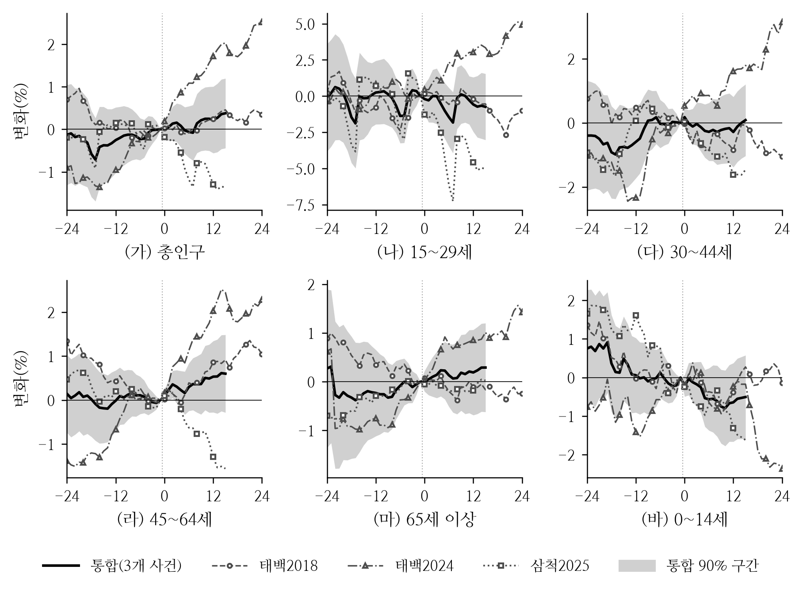
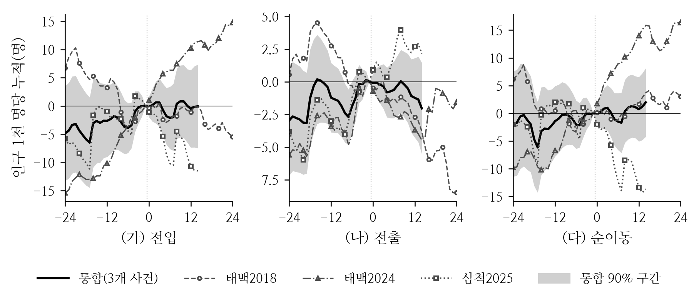

# 석탄 폐광 이후 탄광 도시의 인구 변화

2018년 태백광업소, 2024년 장성광업소(태백), 2025년 도계광업소(삼척) 폐광 전후로 시군 인구가 기존 추세보다 더 줄었는지를 사건별 묶음 국소투영(stacked local projection)으로 추정했습니다.

태백과 삼척의 인구는 마지막 탄광이 닫히기 훨씬 전부터 줄고 있었습니다. 그래서 폐광 뒤의 감소를 그대로 폐광 효과로 볼 수 없고, '폐광이 없었다면'의 경로를 먼저 세워야 합니다. 여기서는 각 시군의 폐광 전 감소 속도를 시군 고정효과로, 같은 시기 비교 시군의 공통 변화를 월 고정효과로 걷어 내고 남는 변화를 봤습니다.

## 결과



- 추세와 공통 변화를 걷어 내면 3개 사건을 합친 12개월 총인구 효과는 0 근처입니다. 약 1% 이상의 추가 감소가 있었다면 검출됐을 정도의 검출력은 있었고, 사양 6가지에서 결론이 같았습니다.
- 연령별로는 45~64세(광부 세대)가 추세보다 덜 줄고, 0~14세는 줄어드는 쪽이었습니다.



- 폐광 뒤 전출은 늘지 않았습니다. 사건마다 갈린 것은 전입입니다. 태백 2024는 전입이 늘어 인구가 추세보다 높았고, 삼척 2025는 전입이 줄었습니다(삼척은 구간이 0을 포함).
- 정리하면 탄광 도시의 인구 문제는 폐광 순간의 '탈출'보다 그 전부터 쌓인 유입 부족과 고령화 쪽에 가깝습니다.

## 방법

```
y(i, t+h) − y(i, t−1) = β_h · 폐광(i, t) + 시군 FE + 월 FE + ε,     h = −24, …, 24
```

- 사건마다 처치 시군 1곳과 비교 시군 103곳(비수도권 시·군 중 1989년 이후 폐광 3곳 이상인 시군 제외)을 한 묶음으로 둡니다. 처치 시점이 다른 시군끼리는 서로 비교군이 되지 않습니다.
- 표본 기점은 사건 기점과, 구간 [t−1, t+h]가 모두 폐광 전인 최근 60개월 기점입니다. 균형 패널이라 이원 고정효과를 정확히 제거할 수 있고, 회귀 계수는 단순 차이 계산과 같습니다.
- 처치 시군이 사건마다 1곳이라 시군 군집 SE는 사건 달의 고유 변동을 담지 못합니다. 실제로 폐광 전 계수의 절반 이상이 군집 SE 기준 90% 구간 밖에 놓였습니다. 그래서 처치 시군의 폐광 전 잔차로 잰 예측오차 SE를 주 구간으로 쓰고, 겹치는 h개월 구간의 자기상관은 Newey-West 장기분산으로 반영했습니다.
- 강건성: 시군별 선형추세, 비교군 강원·전남, 폐광 이력이 전혀 없는 비교군(88곳), 사전 기간 36개월, 같은 달력월 기점만 사용.
- 전입·전출은 시도간 이동과 시도내 시군구간 이동의 합입니다. KOSIS '총전입·총전출'에는 같은 시군 안의 이동이 섞여 있어 쓰지 않았습니다.

## 코드

```bash
cd src
python build_panel.py <원자료_폴더> ../work
python stacked_lp.py ../work/panel_month.csv <폐광수.csv> ../out
python figures.py ../out/lp_all.csv ../out
```

## 데이터

모두 공개 통계이고 저장소에는 넣지 않았습니다.

- 행정안전부 주민등록 인구통계 (시군구, 5세별, 월말) 2008-01~2026-10
- KOSIS 인구이동 (DT_1B26001, 월별), 출생·사망 (DT_1B8000I, 연도별)
- 석탄광 폐광 현황 (공공데이터포털)
