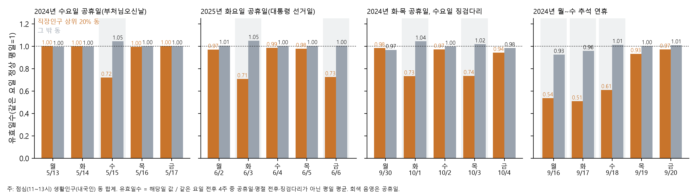
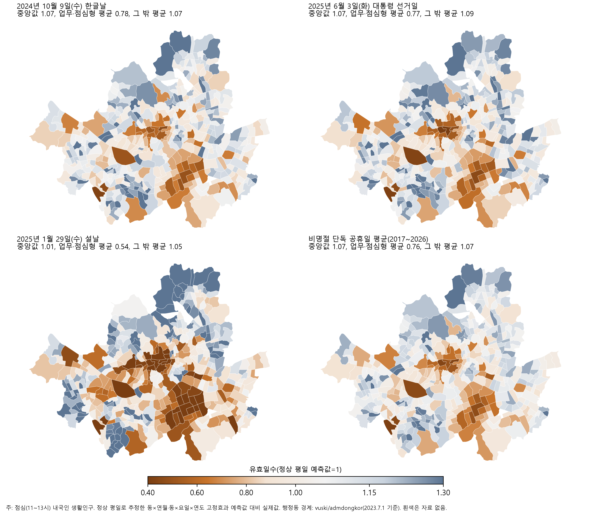

# 평일 공휴일은 어느 상권에서 비는가: 서울 행정동 유효일수

전력수요 예측에서 쓰는 '유효일수(effective days)' 개념을 상권 수요에 옮겨 봤습니다. 평일 공휴일 하루가 정상 평일 몇 일분의 수요에 해당하는지를 서울 행정동 점심시간 생활인구로 재고, 그 값이 상권 유형에 따라 얼마나 다른지 비교했습니다. 2026 소상공인 분야 연구논문 공모전용으로 쓴 논문의 분석 코드입니다.

공휴일 효과는 보통 전국 소비 총량으로 이야기되는데, 직장인이 손님인 업무 상권과 주민이 손님인 주거 상권은 같은 공휴일에 반대로 움직일 수 있습니다. 합쳐 버리면 어느 상권의 소상공인이 공휴일에 손님을 잃는지가 보이지 않습니다.

## 결과

점심(11~13시) 내국인 생활인구 기준, 정상 평일 = 1

| 날짜 | 업무·점심형 | 숙박·관광형 | 야간여가형 | 주거·교육형 | 그 밖 | 업무 − 그 밖 (SE) |
|---|---:|---:|---:|---:|---:|---:|
| 비명절 단독 공휴일 | 0.729 | 0.886 | 1.049 | 1.069 | 1.056 | -0.326 (0.031) |
| 연휴 첫날 | 0.711 | 0.879 | 1.017 | 1.035 | 1.030 | -0.319 (0.032) |
| 연휴 마지막날 | 0.705 | 0.878 | 1.043 | 1.073 | 1.056 | -0.351 (0.032) |
| 평일 명절 | 0.557 | 0.724 | 0.939 | 1.010 | 1.005 | -0.448 (0.032) |
| 명절 전날 | 0.964 | 0.966 | 1.004 | 1.007 | 1.001 | -0.037 (0.006) |
| 명절 다음날 | 0.966 | 0.964 | 0.996 | 1.011 | 1.003 | -0.036 (0.005) |
| 징검다리 평일 | 0.942 | 0.974 | 1.008 | 0.993 | 0.998 | -0.056 (0.009) |
| 토요일 | 0.778 | 0.921 | 1.048 | 1.088 | 1.053 | -0.275 (0.029) |
| 일요일 | 0.708 | 0.881 | 1.051 | 1.101 | 1.078 | -0.371 (0.033) |

- 업무 상권에서 평일 공휴일 하루는 정상 평일의 0.73일분이고, 주거·기타 상권에서는 1.05~1.07일분입니다. 평일 공휴일은 업무 상권에서 거의 일요일(0.71)과 같습니다.
- 명절은 더 큽니다. 업무 상권에서 평일 명절은 0.56일분이고, 명절 연휴 가운데 날은 0.52까지 떨어집니다. 그 밖 상권은 명절에도 1에 가깝습니다.
- 연휴 직전·직후 평일은 업무 상권에서만 3~4% 줄고, 2번째 평일부터는 거의 회복합니다.
- 공휴일 종류별로는 법정·대체공휴일, 선거일, 임시공휴일이 모두 -31% 안팎으로 비슷했고 근로자의날은 -25%로 작았습니다 (날짜 고정효과 모형, 그 밖 상권 대비).





## 방법

```
식(1) 유형별:   ln P_it = Σ_c γ_c C_t^c + μ_i + δ_요일 + λ_연월 + ε        ED_c = exp(γ_c)
식(4) 상호작용: ln P_it = Σ_c Σ_g θ_cg (C_t^c × G_i^g) + μ_i + τ_날짜 + ε    (기준: 그 밖 상권)
```

- P는 행정동 i, 날짜 t의 점심 생활인구. 평일 표본이고 표준오차는 행정동 + ISO 주 이원 군집입니다.
- 날짜유형 C는 공휴일의 연휴 내 위치(단독·첫날·가운데·마지막날), 평일 명절, 명절 전후 1~4번째 평일, 징검다리, 선거일, 임시공휴일, 근로자의날로 나눴습니다 (`src/kr_calendar.py`).
- 상권 유형은 소상공인시장진흥공단 상가정보의 2017~2019년 평균 업종 점포 수로 고정했습니다. 과학·기술 서비스와 음식점이 모두 상위 20%인 동을 업무·점심형으로 봤습니다 (`src/district_types.py`).
- 유형 간 ED 차이의 표준오차는 델타법으로 계산했습니다.

## 코드

```bash
cd src
python living_pop.py <생활인구_zip_폴더> ../work/living_pop
python district_types.py counts <상가정보_zip_폴더> ../work/sangga_counts.csv
python district_types.py types ../work/sangga_counts.csv ../work/types.csv
python effective_days.py ../work/living_pop ../work/types.csv ../out
python figures.py map ../work/living_pop ../work/types.csv <행정동경계.geojson> ../out
python figures.py weeks ../work/living_pop <상권영역.dbf> <직장인구.csv> ../out
```

## 데이터

모두 공개 자료이고, 용량이 커서 저장소에는 넣지 않았습니다.

- 서울시 행정동 단위 생활인구 (서울 열린데이터광장 OA-14991)
- 소상공인시장진흥공단 상가(상권)정보 (공공데이터포털)
- 서울시 상권분석서비스 직장인구·상권영역 (OA-15569, OA-15560)
- 행정동 경계 [vuski/admdongkor](https://github.com/vuski/admdongkor) (2023-07-01)
