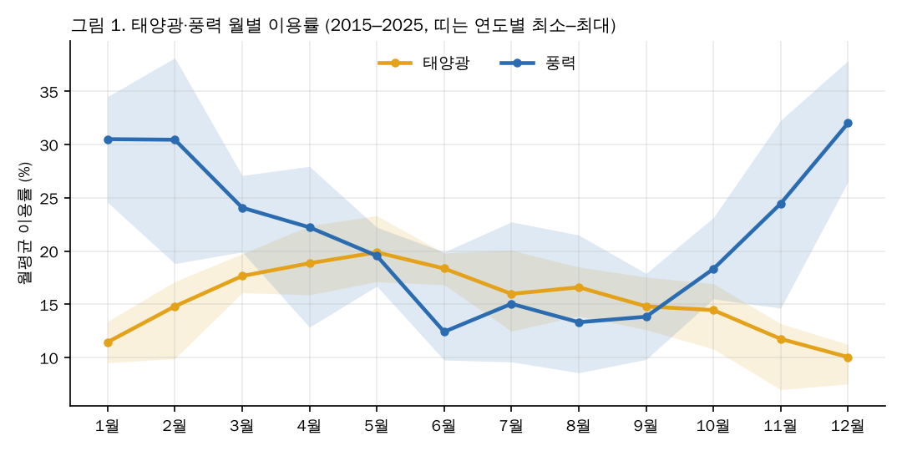
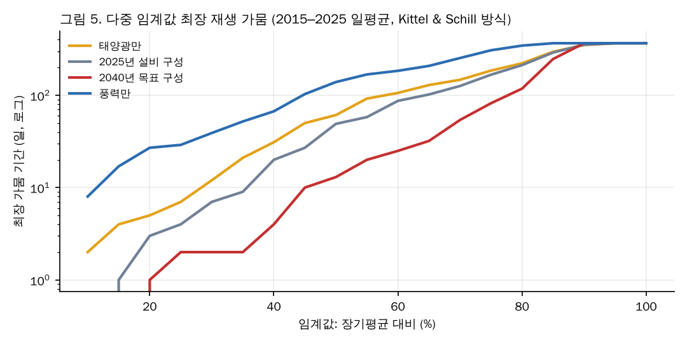
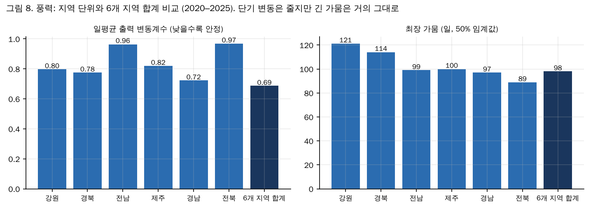
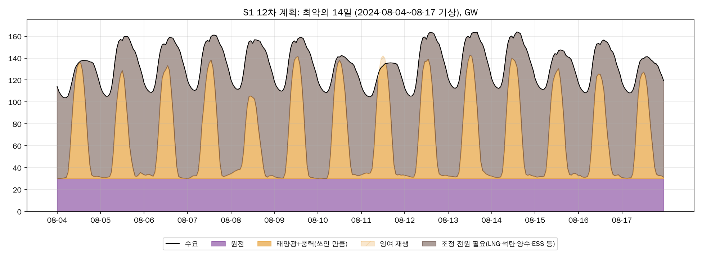

# 한국 태양광·풍력의 상호보완성과 재생 가뭄

2015~2025년 시간별 발전 실적으로 태양광과 풍력이 서로를 얼마나 메워 주는지, 둘 다 약한 날(재생 가뭄)이 얼마나 길게 이어지는지를 봤습니다. 이어서 12차 전력수급기본계획(안)의 2040년 설비를 과거 11년 날씨에 얹어 화력·저장장치가 맡아야 할 부하가 어떻게 바뀌는지 따져 봤습니다.

## 질문

1. 태양광과 풍력은 계절과 날씨 단위에서 서로 반대로 움직이는가
2. 풍력 비중을 늘리면 합계 출력의 장기 공백이 줄어드는가
3. 지역을 넓게 묶으면 가뭄이 줄어드는가 (공간 평활)
4. 2040년 구성에서 조정 전원이 가장 많이 필요한 시기는 언제인가

## 주요 결과



- 계절 단위로는 뚜렷하게 보완적입니다. 태양광은 4~5월, 풍력은 12~2월에 이용률이 가장 높고, 월평균 이용률의 상관은 -0.42입니다. 계절을 빼고 남은 일별 날씨 변동의 상관도 -0.16으로 약하게 음수입니다.
- 장기평균의 50%에 못 미치는 기간이 가장 길게 이어진 것은 태양광만 있을 때 61일, 2025년 설비 구성(풍력 약 6%)에서 49일이었습니다. 2040년 목표 구성(풍력 약 28%)에서는 13일로 줄어듭니다. 풍력만 있으면 139일로 오히려 깁니다.



- 지역 간 상관은 거리에 따라 줄어드는데, 상관길이가 풍력 약 300km, 태양광 약 550km였습니다. 한반도 규모에서는 풍력 지역을 묶어도 유효한 독립 단지가 1.7개 정도라 몇 시간짜리 변동은 줄어도 며칠짜리 가뭄은 거의 그대로입니다.



- 2040년 시나리오(태양광 172GW, 풍력 60.5GW)에서 조정 전원 필요량이 가장 큰 14일은 2024년 8월 기상에서 나왔고 평균 68.6GW였습니다. 필요량 상위 1% 시간은 81%가 7~9월, 81%가 17~21시에 있었습니다. 태양광이 빠지는 여름 저녁이 가장 부담이 큰 시간대입니다.
- 같은 연간 재생 발전량을 태양광 위주로 채우면 잉여 전력이 연 95TWh로 늘고, 풍력 위주로 채우면 잉여는 13TWh로 줄지만 최악 14일 필요량이 80GW로 커집니다. 어느 쪽이든 공짜는 아닙니다.



그 밖의 그림은 `figures/`에 있습니다 (월×시각 히트맵, 풍력 비중별 안정성, 2040년 일별 달력, 봄철 순부하, 연료원별 운전 등).

## 방법

- 이용률 = 발전량 / 설비. 풍력은 2024년 6월부터 거래량 대신 계량값을 씁니다 (중첩 구간 비율 0.98~1.01).
- 재생 가뭄은 Kittel & Schill(2024)의 정의를 따랐습니다. MBT는 L일 이동평균이 임계값 아래인 가장 긴 L, CBT는 일평균이 임계값 아래인 날이 연속된 구간입니다.
- 연료원 반응은 일별 `출력 = a·재생 + b·실제수요 + 연×월 FE + 요일 FE` 회귀이고, 표준오차는 Newey-West HAC(7일, 14일)입니다. 조건부 동행 관계이지 인과효과는 아닙니다.
- 2040년 시나리오는 수요 모양(연평균=1)을 피크 158.4GW에 맞추고 24시간 평탄 부하 26.6GW를 더했습니다. 원전은 30GW로 고정했습니다.

## 실행

```bash
cd src
python panel.py ../data ../work
python complementarity.py ../work ../data/wind_monthly_region_panel.csv
python net_load.py ../work
python fuel_mix.py ../work ../data/fuel_hourly.csv
python scenario_2040.py ../work
```

결과 그림과 표는 `work/out/`에 저장됩니다.

## 데이터

데이터는 저장소에 넣지 않았습니다. `data/`에 아래 형식으로 두면 돌아갑니다. 시각 `he`는 그 시간이 끝나는 시각(1~24)입니다.

| 파일 | 열 | 출처 |
|---|---|---|
| `wind_hourly_national.csv` | date, he, wind_MWh_traded, wind_MWh_metered | 전력거래소 공공데이터 ([`korea-wind-data`](../korea-wind-data)) |
| `wind_hourly_region_metered.csv` | date, he, region, MWh | 전력거래소 5분 계량 |
| `wind_monthly_region_panel.csv` | ym, region, 발전설비용량_MW | EPSIS |
| `wind_capacity_daily.csv` | date, cap_avg | 일별 풍력 설비용량 (EPSIS 설비 기준) |
| `smp_hourly.csv` | date, he, smp | 전력거래소 |
| `fuel_hourly.csv` | date, he, 원자력_MWh, 유연탄_MWh, … | 전력거래소 연료원별 시간 거래량 |
| `solar_hourly.csv` | date, he, region, KPX, PPA, BTM | 아래 참고 |
| `solar_capacity_daily.csv` | date, region, CAP_KPX, CAP_PPA, CAP_BTM | 아래 참고 |
| `demand_hourly.csv` | date, he, demand_MW | 아래 참고 |

태양광(PPA·BTM 포함)과 시간별 수요는 대학원 수업에서 받은 가공 자료로 분석했습니다. BTM은 계량되지 않는 추정치라 공개하지 않았고, 전력거래소가 공개하는 지역별 시간별 태양광 거래량과 시간별 수요로 같은 형식을 만들면 BTM을 뺀 결과를 다시 낼 수 있습니다.
